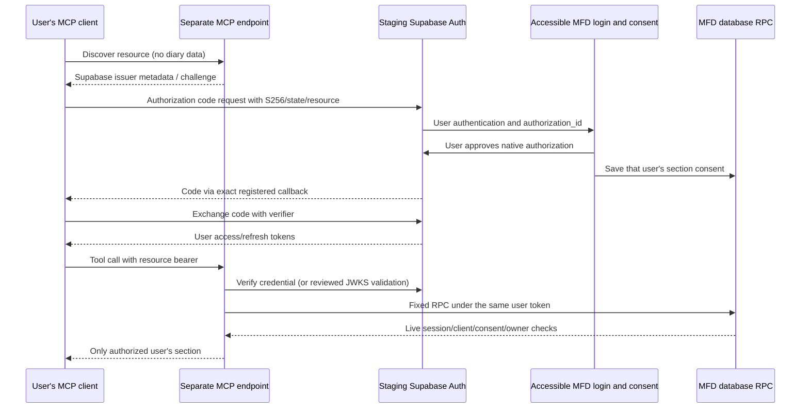

# Phase C.1A.1 — Private Sites MCP and Supabase OAuth compatibility

Date: 2026-10-28 (Europe/Berlin). Branch: `staging/mfd-oauth-testing`.

**Recommendation: B, a separate OAuth-protected MCP endpoint and accessible MFD login/consent surface, for the multi-user goal. C, owner-private browser-only staging, is a smaller optional validation step. A is not established as a supported dual-authentication integration. None is approved for implementation or deployment by this investigation.**

Only this report was added. No application/test/configuration source changes, database access/mutations, OAuth activation, registrations, accounts, deployment, commits, pushes, paid resources or production access occurred. Read-only Site metadata was inspected; no access credential was used. Existing uncommitted work was preserved. Both write switches remain required false; this investigation did not independently reread their hosted values or rerun the database audit from C.1A.

## 1. Root cause and reachability

Three distinct permissions have been conflated:

1. **Site access:** Sites decides whether a caller may view the Site before forwarding native MCP requests. Site-scoped OpenAI identity is not Supabase identity.
2. **MFD authentication:** MFD requires an independently verified Supabase token identifying the diary user.
3. **Diary authorization:** SQL checks the current session, client registration, audience and per-user section consent. Passing either outer layer does not grant data access.

The installed official Sites integration reference documents a native private plugin, not an adapter that obtains Supabase OAuth tokens. It does not specify secondary OAuth linking, Authorization forwarding/replacement, dual challenge routing or how native discovery supplies an MFD bearer. Absence of this contract is **uncertainty, not proof that all dual-layer deployments are impossible**. No such behavior may be invented.

Fresh `get_site` read for `appgprj_6ae0ae64c4e88191a385d9bdb6dc37c5`: custom access revision 1, one allowed owner, no groups/external visitors, publication version 0 and no live URL. Therefore there is no deployed endpoint now; another independent ChatGPT account has no Site viewing grant. Owning an MFD account does not change that. Even after owner-private publication, the current policy would exclude other accounts. No second-account connection was attempted.

MFD also has a protocol gap relative to native Sites integration: it implements `initialize` for 2025-03-26/06-18/11-25, not `server/discover`. **Precision correction to C.1A:** Sites says to *prefer* 2026-07-28; this is not evidence that every other MCP version is globally prohibited. The documented native discovery method is missing regardless. General remote MCP and native Sites provisioning must be evaluated separately.

## 2. Official evidence and limits

| Evidence | Established fact | Not established |
| --- | --- | --- |
| Installed [Sites MCP reference](/Users/prasanthnammi/.codex/plugins/cache/openai-curated-remote/sites/1.1.2/skills/sites/references/site-mcp-server.md) | Manifest capability `mcp`; stateless POST /mcp; server/discover; preferred 2026-07-28; platform checks view permission and provides Site identity; private plugin provisioned on publication | Automatic external Supabase linking, bearer preservation or cross-account plugin distribution |
| Installed [Sites identity/service-access reference](/Users/prasanthnammi/.codex/plugins/cache/openai-curated-remote/sites/1.1.2/skills/sites/references/identity-and-secrets.md) | Browser identity, connected-app consent and service access are separate. A supported service-access header exists and supplies no visitor identity or app consent | Standard ChatGPT connector configuring that credential together with individual Supabase OAuth; permission to distribute a shared Site-access credential |
| [OpenAI authentication](https://developers.openai.com/plugins/build/auth) | OAuth resource-server contract and registration choices summarized below | Automatic compatibility of MFD or Sites with every documented client surface |
| [OpenAI connection/testing](https://developers.openai.com/plugins/deploy/connect-chatgpt) | Remote HTTPS/Streamable HTTP, or supported Secure MCP Tunnel for private testing; account/workspace policies apply | Permission or ability for every account to install a private custom integration |
| [Supabase MCP authentication](https://supabase.com/docs/guides/auth/oauth-server/mcp-authentication) | Existing users can authorize MCP access; preregistration and optional DCR are documented | CIMD support in this staging project, or bypass of MFD's extra client/section checks |
| [Supabase deployment walkthrough](https://supabase.com/docs/guides/ai-tools/byo-mcp) | Separately hosted authenticated MCP with discovery, token validation, RLS and a frontend consent screen is documented | That its sample can replace MFD security unchanged; its sample DCR configuration is not approval to enable DCR here |

Sites evidence is the installed vendor integration contract, not a discovered public promise of arbitrary dual OAuth support. The [connected-app reference](/Users/prasanthnammi/.codex/plugins/cache/openai-curated-remote/sites/1.1.2/skills/sites/references/app-integrations.md) handles declared eligible connectors and visitor consent; it does not document registering MFD's arbitrary Supabase project as an external identity provider for this native MCP server.

### ChatGPT registration and protocol requirements

Official OpenAI documentation names **CIMD, DCR and predefined OAuth clients**. CIMD is preferred when supported; DCR remains available. Thus C.1A's registration uncertainty should not be read as “ChatGPT only supports dynamic registration.” Predefined registration is the smallest candidate compatible with MFD's existing explicit client allowlist. The actual account's connection UI, accepted token-endpoint method and callback still require read-only verification.

For CIMD, documented methods include `none` and `private_key_jwt`; choose only the provider/client intersection. No evidence establishes Supabase CIMD/private-key assertion compatibility here. Do not advertise capabilities merely to match ChatGPT.

Copy callback/client metadata from the real management screen. Current documentation describes stable or callback-ID-specific redirects depending on issuer-response identification. Exact issuer/resource matching, S256, refresh, per-tool OAuth declarations and tool-level reauthorization signals matter. Never assume one historical universal callback. OpenAI-managed mTLS identifies a client, not an MFD user. Customer API keys/service credentials are not a substitute for user OAuth. [Source](https://developers.openai.com/plugins/build/auth).

The installed Sites protocol preference and MFD's implemented versions differ. For B, choose and test a mutually supported Streamable HTTP version using the selected client's current contract and official SDK; do not blindly force Sites' preferred version onto all providers. The Supabase walkthrough uses initialize-based HTTP, providing independent evidence that this family remains relevant. Generic version negotiation does not prove native Sites plugin compatibility.

Supabase supports authorization-code PKCE and a custom consent UI. Its frontend must be accessible to the person authorizing. Preregistered public/confidential clients are documented; exact redirect and token-endpoint configuration must be reviewed. [Setup](https://supabase.com/docs/guides/auth/oauth-server/getting-started), [flows](https://supabase.com/docs/guides/auth/oauth-server/oauth-flows).

## 3. Architecture comparison

| Dimension | A — Existing private Sites MCP + Supabase | B — Separate protected MCP + Supabase | C — Private browser-only Site |
| --- | --- | --- | --- |
| Support | Each layer documented separately; combined native-plugin contract unverified | Documented remote MCP/OAuth architecture; MFD implementation and client acceptance still need testing | Documented private Site/browser access; no MCP integration claim |
| Authentication | Site view permission, then independent Supabase verification and live SQL consent | Client discovers external resource, runs Supabase PKCE, user signs into MFD/consents, client sends user bearer to external MCP | Site browser sign-in, then existing separate MFD browser session |
| Access boundary | Two gates; no identity equivalence; current owner-only gate excludes others | Public network address, authenticated private data. Discovery may be public; all diary tools require verified user credentials and SQL authorization | Owner access only under current Site policy; MFD browser RLS remains |
| Source changes | Native discovery/capability plus a vendor-supported dual-auth mechanism not yet specified; no reliable exact implementation available | Separate entrypoint/config and accessible login/consent; resource alignment; compatible SDK/transport and tool-auth signals; details below | No native MCP capability; explicitly keep MCP integration outside browser-only acceptance. Disabling/rejecting MCP routes would be a separately approved change |
| Hosted configuration | Publication and any sharing/plugin changes; OAuth/hook/client settings; cannot remain owner-only and admit arbitrary users | External HTTPS hosting, new exact audience, reachable Auth UI, OAuth/hook/client registration after approval; private Site stays unchanged | Owner-private publication only; OAuth remains disabled, no clients/accounts created implicitly |
| User experience | Potential double linking plus Site grant/invitation; ordinary users currently blocked | Each user connects ChatGPT and authorizes their own MFD session/sections; account/workspace installation rules still apply | Owner can inspect diary browser; no assistant account connection |
| Main risks | Unspecified token/challenge routing, identity confusion, shared credential distribution, gate denies onboarding | Public attack surface, throttling, correct audience/issuer, consent accessibility, refresh/revocation, origin separation | Limited multi-user validation; accidental interpretation of browser success as MCP success |
| Complexity | Unknown/high until platform contract resolved | Moderate, explicit security boundary and independent endpoint lifecycle | Lowest; browser acceptance only |
| Recurring usage | Sites/DB/Auth quotas; extra broker if needed would add unapproved cost/operations | Hosting requests/CPU/egress, Auth MAU/DB usage; optional domain. No fixed paid plan selected | Existing Sites/DB/Auth usage; no new MCP hosting |
| ChatGPT | Native owner use documented in principle; dual Supabase flow unverified | Intended supported OAuth pattern, subject to chosen registration mode and end-to-end acceptance | Browser only |
| Claude/Gemini | No documented access through Sites' private native plugin; cannot reuse ChatGPT Site identity | Standard remote-client candidates, each with registration/callback/version tests | No MCP support |
| Every user connects own MFD account? | **No as configured**, and dual flow unresolved | **Architecturally yes for eligible/authorized users**, not a guarantee of every ChatGPT plan/workspace or completed implementation | **No**; does not meet the MCP product goal |

### A: coexistence conclusion

Separate HTTP headers make two credentials conceivable, and Sites documents service access. That does not establish an interactive per-user ChatGPT integration. Giving everyone an owner-level service credential is neither required nor recommended. We did not request, transmit or test one. Do not infer that Authorization is consumed, preserved or overwritten by dispatch: documentation does not establish that behavior here.

Even confirmed bearer forwarding would not solve current Site audience, native provisioning discovery or user login/consent access. A requires a supported token-linking contract and a separately reviewed access/distribution decision. Never substitute Site user ID/email for auth.uid(), auto-link accounts by email, relax SQL grants, or make this Site public to obtain compatibility.

### B: recommended product architecture

The existing native-approval/local-consent nontransactionality remains: a client may receive a code before local permission storage completes. Until it does, SQL denies private access; failure requires revoke/reconnect. The diagram shows logical responsibilities, not a new atomic guarantee.

**Critical completeness requirement:** a separate MCP endpoint alone is insufficient. Current consent/login pages are on the owner-private Site. B must provide an independently accessible, authenticated MFD authorization surface for intended users, or an explicitly approved alternative access arrangement. Keep the existing Site private and untouched. A narrow separate auth web surface is preferable to changing that Site's audience. Do not proxy it with an owner credential or assume cross-origin HttpOnly cookies are portable.

A documented hosting candidate is a staging Supabase Edge Function; a separate HTTPS Worker is another implementation option. Select one after runtime/limits/cost review, not by silently provisioning. The Supabase guide explains discovery before user authentication and application token verification. Its gateway settings must be reviewed as part of the security design; do not copy `verify_jwt=false` without a fail-closed application validator for every protected request. Anonymous discovery is not anonymous diary access. Keep the existing MCP RPC authorization, not the sample's generic table access.

## 4. Exact proposed changes for B — not implemented

1. Add an isolated MCP deployment entrypoint using the existing fixed read tools/RPC. Do not route through native Sites access. Permit only metadata/discovery unauthenticated; verify credentials before all diary operations. Keep write tools unavailable and DB writes false.
2. Refactor staging configuration deliberately: `src/environment.ts` currently pins resource to Site origin + /mcp and rejects overrides; `hosting/worker/mcp.ts` builds challenge URLs from origin; consent/proposal links and browser CSRF origin live in mfd.ts/mcp-consent.ts. Define separate exact MCP resource origin/path and auth UI origin without allowing arbitrary caller-supplied origins, endpoints or issuer overrides. Existing private browser config must retain its identity.
3. Host a narrow login/consent/manage-connections surface reachable by each intended user. Preserve verified first-party Supabase cookies, CSRF, PKCE, fixed redirects, selected section grants and revoke-first behavior. Use separate origin cookies; no credentials in query strings, frontend storage, tool arguments or cross-origin forwarding. A secure sign-in continuation is required; current “sign in in another tab” must point to a reachable surface.
4. Align the **active database resource setting**, column default, hook output, resource metadata and validators with one exact new staging audience. Current dispatcher/hook read a single resource value: moving B changes it and invalidates old-audience tokens. Plan an explicit reviewed staging-only configuration change with rollback/before-values; do not assume a source-only change suffices or enable multiple audiences. No SQL prepared/applied here.
5. Prefer a single preregistered test client if the actual ChatGPT interface supports the provider's method; keep DCR disabled. One client can authorize many users, whose identities remain different verified sub values. Separate client IDs per person are not inherently required. Native provider registration and MFD's SQL allowlist are separate controls. If DCR is later required, reconcile safe onboarding with that allowlist before approval; never auto-approve every registered client. CIMD requires independently established provider support.
6. Adopt/test the selected transport negotiation, per-tool OAuth metadata and reauthorization responses. Do not invent section OAuth scopes: current SQL section permissions are distinct from identity scopes. Preserve API argument rejection, SQL owner derivation, live session/client/consent and restrictive direct-API OAuth policies.
7. Add bounded abuse controls supported by the chosen host, correct 429/retry guidance, logs without bearer/session/authorization content and release-specific dependency review. No new paid limiter/binding without approval. Preserve replay/CAS architecture even while writes remain disabled.
8. Later approved tests must cover actual S256/state/resource/callback, incorrect issuer/audience/signature/expiry/client, no consent, revoked session/grant, refresh rotation, Alice/Bob isolation across MCP and direct REST/RPC/storage, reconnect, malformed traffic and real concurrency. Metadata and mocks alone cannot establish hosted compatibility.

## 5. Security implications and clients

All architectures must retain verified Supabase subject → auth.uid() ownership; never accept assistant user_id or Site identity as the diary account. No service-role credential is needed for runtime reads. Keep RLS, restrictive OAuth policies, live consent/session checks, private schemas and both false write switches. Per-user authorization and client authentication are independent; “this is ChatGPT” does not mean “this is Alice.”

Claude documentation offers published identity, automatic registration or own-client options and states remote connectors originate from its cloud. B must work without a private Sites browser session; use the exact chosen callback. [Claude source](https://support.claude.com/en/articles/11176164-use-connectors-to-extend-claude-s-capabilities).

Gemini CLI documents HTTP/SSE OAuth discovery, a browser/local callback listener and issuer-response checks. Confirm a fixed approved callback/registration mode before acceptance; this is not evidence for Gemini's consumer web interface. [Official CLI source](https://github.com/google-gemini/gemini-cli/blob/main/docs/tools/mcp-server.md).

No vendor-specific identity conversion or shared master bearer is proposed. Broader user installation/distribution is separate from successful developer testing; plan/workspace policy and release review can limit reach. “Every MFD user” is a product goal supported by B's separation, not a universal vendor entitlement guarantee.

## 6. Costs and usage limits

Investigation cost: no new resources or subscriptions. Existing platform usage may count toward quotas.

- A/C: no verified Sites price/entitlement was obtained; do not promise free publication or unlimited users/traffic. Sharing/private-plugin distribution and any upgrade require account-specific confirmation.
- B Edge Function candidate: official current quota is 500,000 invocations on Free, 2 million on Pro/Team; paid-plan overage is $2/million. Within an existing Free quota, incremental invocation charge can be $0; CPU/runtime/egress/DB/MAU/email and overall project limits still apply. This is not approval for a paid plan or assurance of end-to-end free hosting. [Function pricing](https://supabase.com/docs/guides/functions/pricing).
- Supabase documents no separate MCP authentication charge; users count toward existing MAU quotas. [Authentication costs](https://supabase.com/docs/guides/auth/oauth-server/mcp-authentication).
- A separate Worker/domain/auth web host needs a quote/entitlement review before selection; no numerical cost is invented. Client subscriptions may be required by vendor/account policy. Secure MCP Tunnel is a documented testing alternative, not proof of zero-cost multi-user production hosting or a workaround for Sites permission.

## 7. Non-mutating local evidence

Ran an in-memory esbuild/VM characterization with write:false, no network, synthetic credentials and an Auth double:

- Site identity headers without Supabase Bearer → 401, zero upstream calls.
- Valid-shaped synthetic bearer + server/discover → JSON-RPC -32601.
- MCP-Protocol-Version 2026-07-28 → 400.
- Existing bearer path + tools/list → five read-only tools.

All four checks passed. These prove current source behavior only, not real signature verification, native Site dispatch/header handling, protocol acceptance by a hosted client or OAuth compatibility. No test source was changed. Prior 32/32 C.1A results remain historical; no full regression rerun is claimed for this report-only investigation.

## 8. Remaining uncertainties, smallest next step and C.1B decision

**A unresolved:** ask Sites support for the exact supported external OAuth account-linking/token-forwarding contract, native discovery credential behavior, viewer/private-plugin distribution, token header separation and whether individual users can link different Supabase accounts. Do not send credentials or user data. No support message was sent. A successful owner-only mock would not answer these questions.

**B next, recommended:** a separately approved design/local-only implementation phase. First inspect the intended ChatGPT account's existing connection interface without saving anything: confirm predefined-client support, token-endpoint method and callback source. Obtain provider confirmation if that interface cannot establish them. Choose the isolated MCP + auth UI hosting boundary and quotas, then prepare exact source/configuration diffs and local tests for review. Leave OAuth off and all hosted objects unchanged until a later explicit activation/deployment/account-test approval. This is smaller and safer than implementing a new token broker or weakening Site access.

**C optional:** separately approve browser-only private staging publication if useful to validate diary behavior. It does not resolve or satisfy independent-user MCP acceptance and is not authorized by this report. Retain owner-only access; no source-helper auto-commit/push without approval.

**Phase C.1B:** multi-user MCP deployment/OAuth activation **cannot proceed safely now**. The supported architectural pattern B is established, but its hosting/auth UI configuration, concrete registration compatibility, implementation and hosted acceptance are not. C can be considered only under an explicitly browser-only scope with the earlier artifact/provenance/security gates. No architecture was implemented or deployed. Stop for approval.
